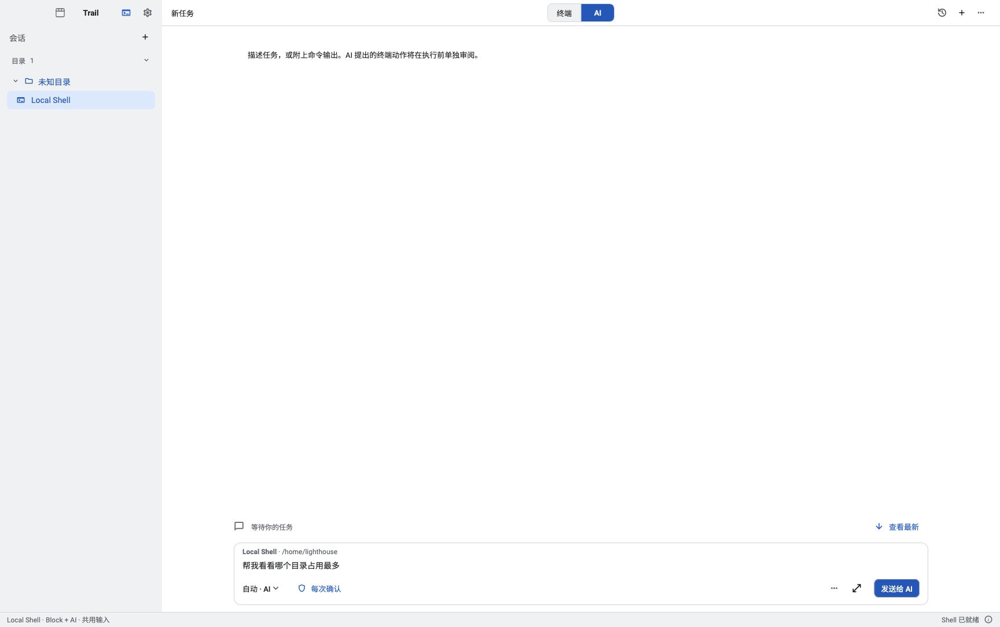
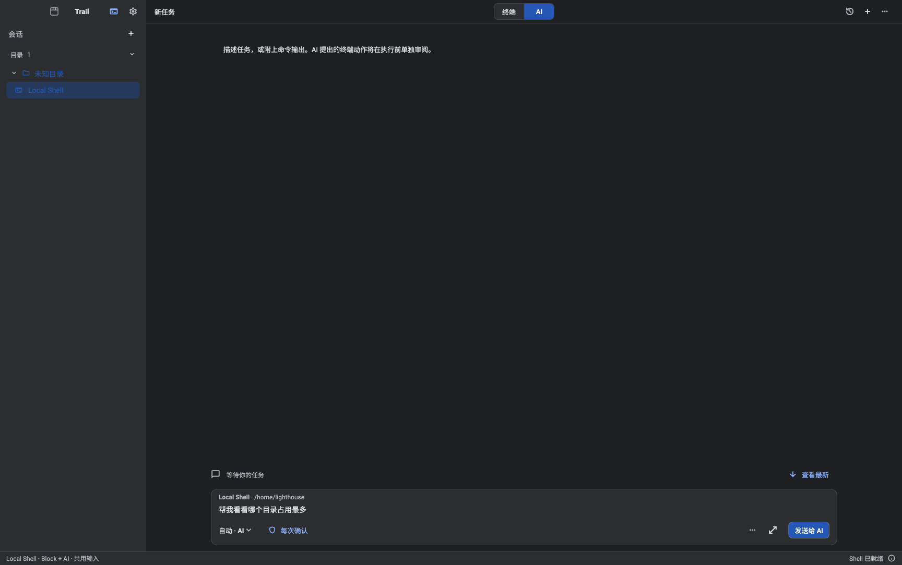
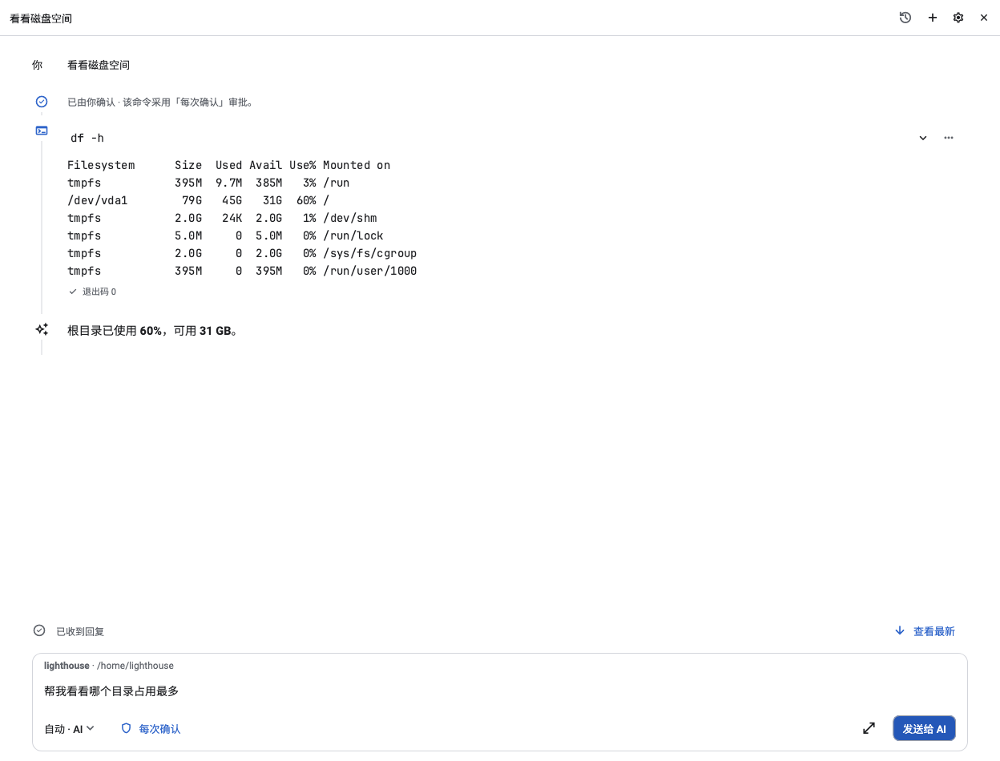
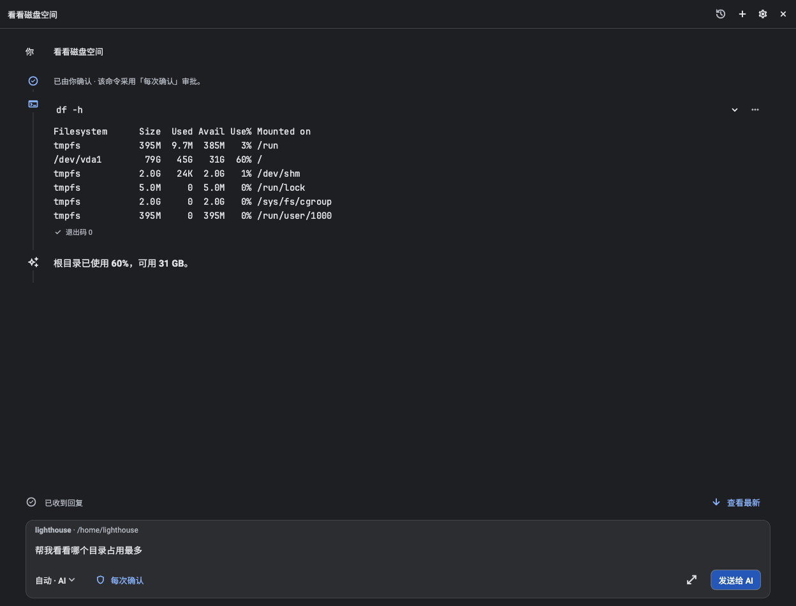

# macOS AI task journal

See the 2026-11-03 section of [design QA](../../../design-qa.md) for implementation decisions, visual comparisons, and validation limits.

## Completed window header





Regenerate full-window captures from `example/` with `IANVS_CAPTURE_DESKTOP_CHROME=1 flutter test --no-pub test/shell/desktop_unified_chrome_test.dart --plain-name "AI header shares"`.

## Conversation content





Regenerate from `example/`:

```sh
flutter test --no-pub test/design/macos_ai_journal_test.dart --dart-define=AI_JOURNAL_EVIDENCE_DIR=/absolute/path/to/evidence
```
