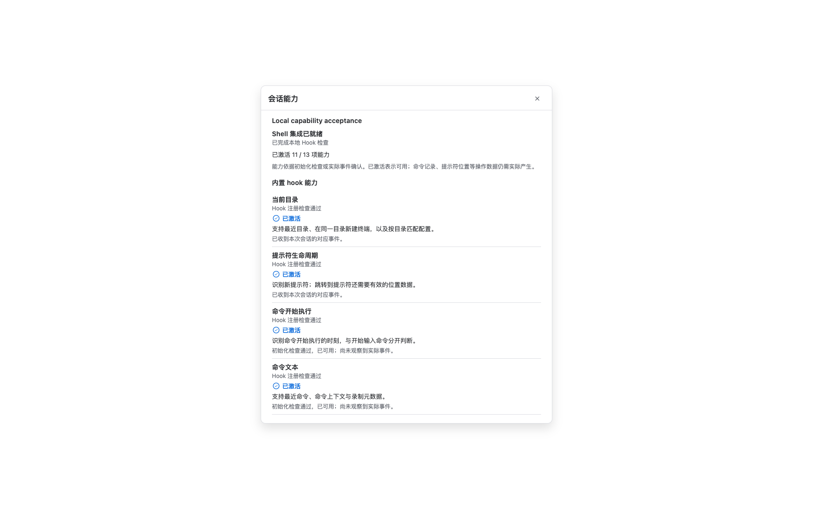
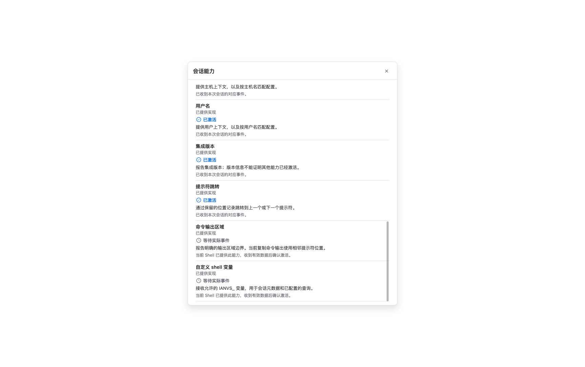
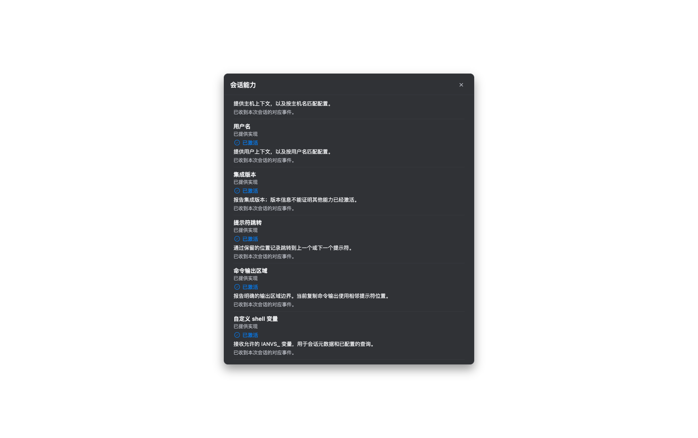

# 本地 Shell 能力补齐与真实验证

2026-10-17；PR #12，保持 Draft，不合并。本轮验证使用独立测试 App，没有覆盖 `/Applications/Trail.app`。

## 实际用途与改动

- 主机和用户提供会话上下文、自动配置匹配及本地/远端目录判断；版本用于兼容诊断。内置 zsh/bash/fish 启动后从系统读取身份，在 `precmd.pwd` 中上报身份及集成版本 `2`。
- 提示符位置用于上一/下一提示符跳转。原生解析器原本已生成真实 prompt zone，修复应用能力模型漏认 `zone_opened` 的问题；没有用无坐标的 precmd 消息冒充位置。
- 输出区域用于 Block 内容与 AI 命令上下文。继续使用真实原生 output zone，必须等命令结束才确认；普通终端的现有“复制命令输出”仍采用相邻提示符位置。
- `ianvs_set_user_var IANVS_PROJECT 'my-project'` 显式提供已有变量查询所需的元数据。不自动读取或上报环境变量，也未新增依赖变量的 UI 功能。沿用有界变量存储，拒绝非法名称、过长数据、旧 context 及备用屏幕输入。
- 检查结果明确区分 `provided` → 等待实际事件、`not_provided` → 尚未提供、`unverified` → 待确认。已观察的真实事件不会被后续初始化回执降级。会话控制器白名单、模型、诊断状态和中文/英文界面一起接通。

## 验证环境

- macOS **27.0.1 (26A434)**，Apple Silicon。
- Flutter **3.44.8** / Dart **3.12.2**。
- 真实 PTY：系统 zsh **5.9**、系统 bash **3.2.57**、Homebrew bash **5.3.20**、fish **4.9.3**。
- 使用临时 HOME/ZDOTDIR/XDG 目录及最小用户配置，不借用用户正在运行的会话。fish 为本轮安装的测试依赖。

## 结果

| 验证 | 结果 | 证据 |
| --- | --- | --- |
| 真实 PTY 与解析边界 | **5/5** | [native.log](native.log) |
| Shell 初始化、冲突、嵌套切换 | **19 通过，1 项环境依赖跳过** | [bootstrap.log](bootstrap.log) |
| 原 Composer 路径/命令补全、原始输入、单次提交与嵌套 Shell | **8/8** | [composer.log](composer.log) |
| 会话模型、控制器、能力界面、关闭与录制生命周期 | **197/197** | [sessions.log](sessions.log) |
| 终端运行时事件解析与传递 | **232/232** | [runtime.log](runtime.log) |
| macOS 原生 App 能力页 | **1/1** | [app-native.log](app-native.log) |
| 应用/终端包静态分析、变更格式、diff、core 镜像 | **通过** | [checks.log](checks.log) |

原生 App 通过真实 zsh 及应用 SessionController 验证：

1. 首次提示符 **11/13**，真实版本与提示符位置已保存；命令历史为空。输出范围与自定义变量均为“等待实际事件”。
2. 执行 `printf 'capability-output\n'; false` 后 **12/13**，获得真实关闭的输出区域。
3. 执行显式变量设置后 **13/13**，收到 `IANVS_PROJECT=project 中文`。仅出现对应实际事件才激活。

Rust PTY 验证对上述四种 Shell 比较实际 hostname / id 返回值，检查命令输出区域不混入提示符、保留退出码 1、变量中文内容以及非法名称返回 2。另以解析器输入验证旧 context、备用屏幕和超长值拒绝。

首次原生验收发现控制器仍过滤新检查状态，已修复并用同一验收重跑通过。截图等待滚动/主题绘制完成，避免把中间帧作为视觉证据。

## 原生渲染截图

## 边界

- 本轮是本地 Shell 验证；没有运行依赖独立 OpenSSH fixture 的整套远端验收，相关用例明确跳过。共享内存引导和嵌套 Shell 回归已运行。
- 未新增 iOS、Windows、Linux 原生运行结果，也未覆盖其他受支持 macOS 主版本。支持范围不等于验证范围。
- 11→12→13 是纯净 fixture 的实际结果。用户配置冲突、系统身份命令不可用或事件尚未发生时，不承诺固定计数。
- 原生 Flutter runner 报告未能将测试窗口切至前台，但测试 App 成功运行、事件断言完成，截图来自该 App 的 Flutter 渲染结果。
