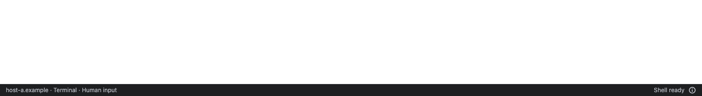
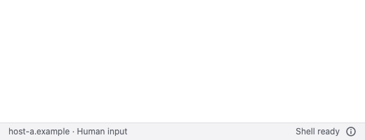
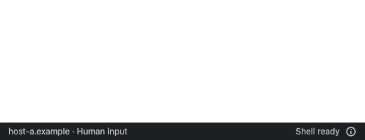
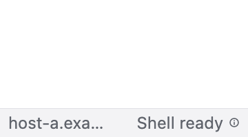
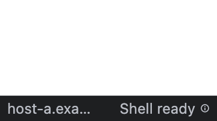

# 状态栏位置与可选变量说明

底部状态使用紧凑靠右对齐，详情图标保留在状态文字旁；左侧保持当前会话、模式和输入归属。原布局的松约束 Flexible 没有占满分配区域，导致状态停留在中间。现在用 Expanded + 尾端对齐消除剩余空白，不改状态判定或详情点击交互。

自定义变量名称标注“可选”，说明 `IANVS_` 只是前缀，用于脚本保存会话信息及获准查询；不设置也不影响终端和 AI。能力计数及协议行为不变。

21 项状态栏/能力弹窗测试、23 项现有桌面预览/只读观察回归及应用静态分析通过。六组组件渲染覆盖深浅色 × 1440、520、360 逻辑像素；360 使用桌面双倍文字。保持详情点击和完整无障碍说明，窄窗口按原规则省略长文字。

截图来自 Flutter 组件测试（英文固定 fixture），不是新安装或真机截图。

