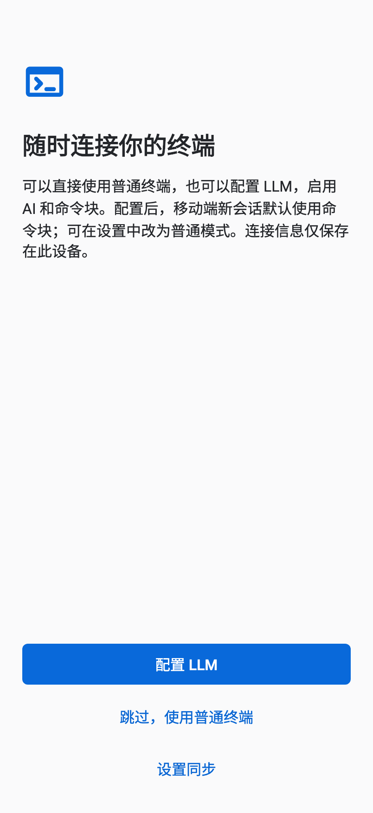
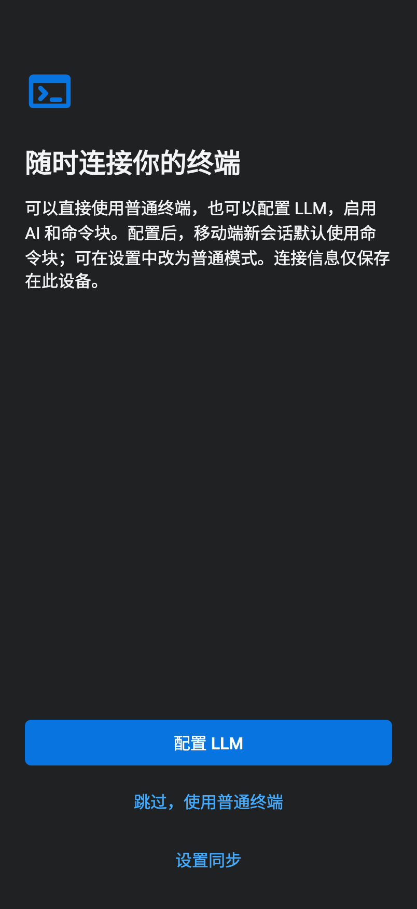
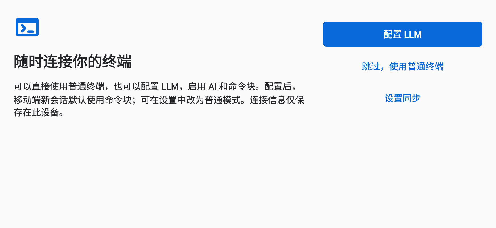
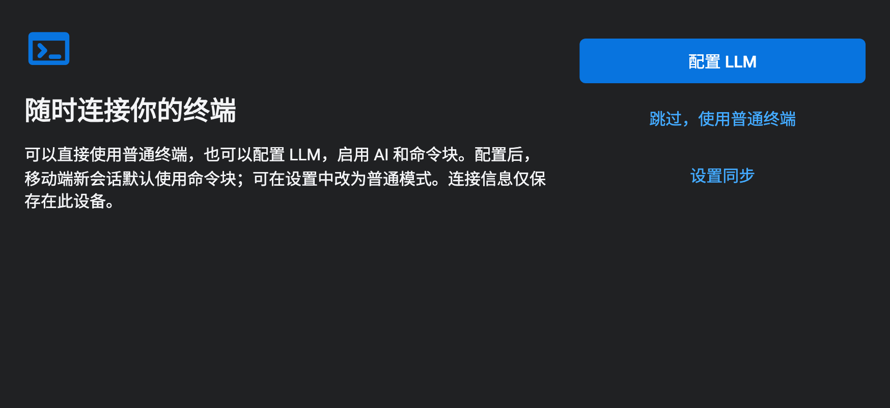

# 移动端首次 LLM 配置与模式门槛（2026-10-16）

iOS / Android 首次安装的欢迎页提供「配置 LLM」和「跳过，使用普通终端」。复用设备本地 AI 配置表单；完成现有本地/同步选择后，不在后续启动重复显示引导。已有安装保持原有数据与连接。

## 行为

- 未配置 LLM、配置尚未加载、存储读取失败、配置无效或仅有桌面 ACP 配置：移动端只能使用普通模式。已保存的 Block 偏好不能绕过限制。
- 有效 LLM 配置是指 endpoint、API key、model 通过现有本地校验；不以实际模型调用成功作为解锁条件，不自动发起任务或执行命令。
- 配置 LLM 后，新会话默认 Block；设置 → 通用 → 默认终端模式选「普通」可关闭默认启用。用户的显式普通模式偏好保留。Block 仍需 Shell 能力支持。
- 移除 LLM 后，移动端现有 Block 立即退回普通模式，已打开的 AI 退出输入所有权，命令草稿保留。重新配置后不抢回已回退会话的输入，用户可从会话菜单手动切回；新会话按默认偏好创建。
- 无配置时点击 AI 打开配置表单；表单期间终端输入停用，保存不会自动发送。设置中的 Block 选项不可选，会话菜单/重新检查/重新输入命令均受同一门槛约束。
- 桌面不增加 LLM 前置条件。原有桌面 Block 和 ACP 行为保持。

## 验证

- 相关 AI、Composer、移动会话、模式与启动回归：**802 通过，1 项既有失败**。包含 19 项新增用例：iOS/Android 配置与跳过、缺省/显式 Block 偏好的限制、配置移除与草稿、桌面无 LLM、延迟读取、无效/ACP/读取失败。
- 既有失败：`reduced motion session menus preserve input and grid on TargetPlatform.iOS`，设置返回后的 resize 次数 3、预期 1。改动前 PR HEAD `e43e924c` 的 Flutter CI 也失败；此前同一失败已记录于 [CI 38410855545](https://github.com/robinfai/ianvs-terminal/actions/runs/38410855545)。没有将失败或旧真机验收计作本次通过。
- 设置、偏好持久化与字号策略回归另有 **60/60 通过**。
- 首次引导深浅色、横竖屏及桌面错误/同步等 **36 个组件截图场景通过**。下方 4 张为生产引导视图在组件测试中的截图，使用固定测试字体；不是原生模拟器或真机截图。手机 402×874 / 874×402，导出倍率 2。
- 最后接入应用已有手机固定字号策略后，启动测试再次 **20/20 通过**；静态分析无问题；18 个变更 Dart 文件格式检查通过；core 镜像同步检查通过。
- `flutter build ios --simulator --debug --no-pub -t lib/main.dart` 成功，产物为 `example/build/ios/iphonesimulator/Runner.app`。这是构建检查，本次未启动原生模拟器交互验收、未安装真机、未调用真实 LLM。

以前在移动端模拟「尚未加载配置但已进入 AI」的 5 项异步提交保护测试，迁到仍允许该路径的桌面平台继续执行；移动端改由无配置/加载等待门槛测试覆盖。移动端后台撤销、审批与焦点测试仍在 iOS 运行，测试夹具显式提供 LLM 配置。

## 界面

| 浅色竖屏 | 深色竖屏 |
| --- | --- |
|  |  |





## 复跑

在 `example` 目录执行：

```sh
flutter test --no-pub test/ai test/terminal_composer test/shell/mobile_terminal_modes_test.dart test/startup/app_startup_host_test.dart test/shell/mobile_sessions_lifecycle_test.dart
flutter test --no-pub --dart-define=FULL_UI_EVIDENCE_DIR=/tmp/trail-onboarding test/startup/app_startup_host_test.dart --plain-name 'UI review startup'
flutter analyze --no-pub
flutter build ios --simulator --debug --no-pub -t lib/main.dart
```

日志及源码 SHA-256 均见 [evidence](evidence)。PR 保持 Draft，不合并。
