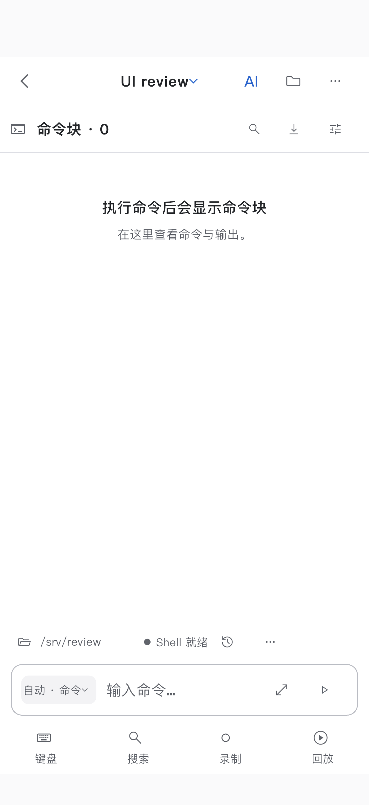
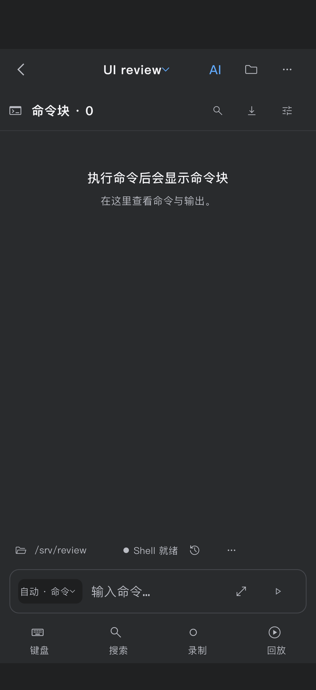
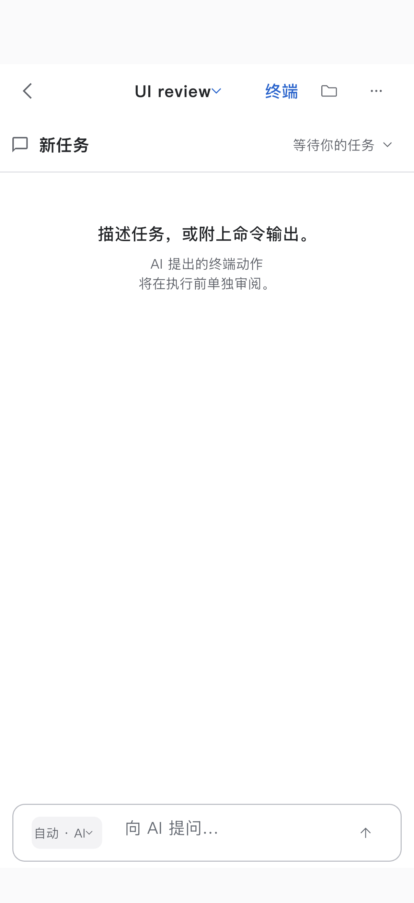
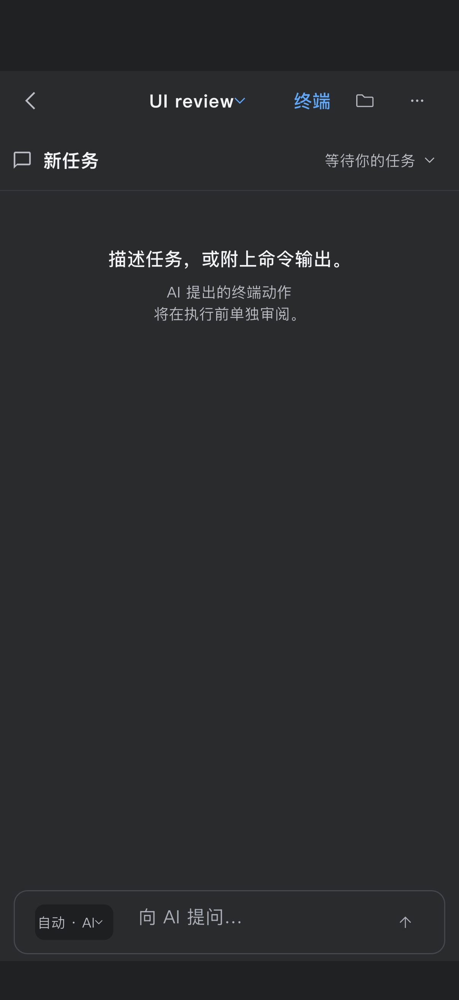
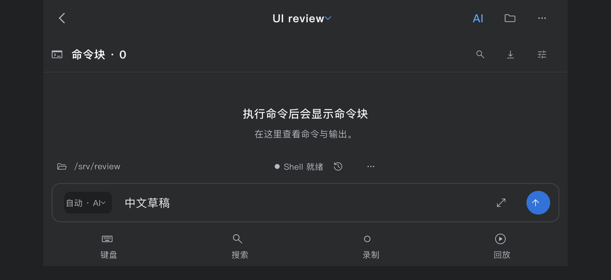

# Block and AI visual alignment — 2026-10-13

The default Block composer previously occupied a tall card while AI used a compact
reading surface. Both now share 12-point corners, neutral borders, a 96-point
mode slot, 44-point action targets, and a 56-point input surface after keyboard
dismissal. Block keeps its path, ownership, history and more controls in a separate
context row; the 56-point measurement excludes that row and the terminal toolbar.
The secondary bars are 52 points, and empty-state typography and positioning match.
All existing actions and menu choices remain available.

Editing still expands vertically, and the full-screen draft editor preserves text
and selection. A Return action arriving before the focus rebuild now keeps focus
rather than invoking Flutter's single-line completion default. The existing test
checks both zero submissions and subsequent hardware Shift+Enter insertion.

## Verification

- 925 passing design / composer / AI compact tests; the one optional desktop sidebar
  capture was explicitly enabled and passed separately. Existing visual goldens pass.
- 199 passing command composer and mobile Block behavioral regressions.
- Paired coverage: 320×740, 402×874 and 874×402, light/dark, empty/two-line draft,
  focus/dismissal/full-screen editing, retained selection and zero submissions.
- Native iOS **26.3.1 simulator**, iPhone 17 Pro, DPR 3: 402×874 portrait and
  874×402 landscape; each run passed all four scenarios plus teardown. Actual
  ShellScreen navigation keeps independent Block and AI drafts and zero backend
  command/write counters. Twenty paired native PNG originals are archived.
- Both appearances and orientations measure **56.0 logical pixels** for each
  dismissed input, empty or with a retained two-line draft; both secondary bars
  measure **52.0**. There were no overflow exceptions.
- Changed-source static analysis, formatting, diff checks and generated core
  synchronization passed. An unscoped workspace analyze also visited old ignored
  `build/**/review_main.dart` scratch files and reported 34 informational lints;
  no tracked source issue was reported. Those unrelated scratch files were left intact.

This is simulator UI verification with in-memory backends, not live SSH or physical
phone acceptance. Integration screenshots contain application pixels; they do not
include the OS keyboard pixels. The latest changes have not been installed on the
phone. CI for the new commit is pending; the prior 97f82ff4 run passed 8/8. Keep
PR #12 Draft and unmerged.

## Evidence

All links refer to this checkpoint's native run:

- [Measurements](../mobile-block-ai-v1/evidence/shared/block-ai-alignment-2026-10-13/measurements.json)
- [Original image hashes](../mobile-block-ai-v1/evidence/shared/block-ai-alignment-2026-10-13/capture-manifest.json)
- [Production source hashes](../mobile-block-ai-v1/evidence/shared/block-ai-alignment-2026-10-13/source-sha256.json)
- [Portrait log](../mobile-block-ai-v1/evidence/shared/block-ai-alignment-2026-10-13/native-portrait.log) / [landscape log](../mobile-block-ai-v1/evidence/shared/block-ai-alignment-2026-10-13/native-landscape.log)

| Native portrait, light | Native portrait, dark |
| --- | --- |
|  |  |
|  |  |

