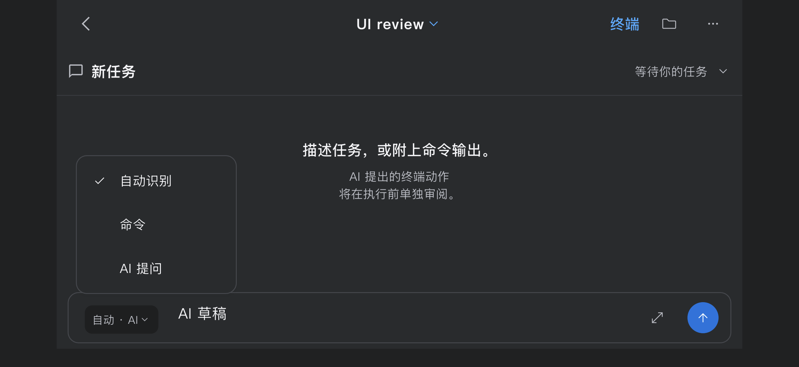

# Mobile intent menus — 2026-10-14

Block and AI now use one `ComposerIntentMenu` for the phone input-intent selector.
The menu shares typography, a selected checkmark column, 48-point rows, 12-point
corners, theme-based colors/border/shadow and the same three labels. The button
has 8-point horizontal padding (previously 2), a 44-point touch target, and a
108-point layout slot including the trailing gap. Existing intent availability,
selection callbacks and draft controllers remain in place.

Opening the menu preserves editor focus and the software keyboard. `MenuAnchor`
tracks the button's actual layout instead of using a popup route's stale position.
The selector keeps the same element location inside a Stack when the composer
changes between one and two rows. The mobile scroll host also stays mounted when
a landscape keyboard crosses the short-window threshold. Keyboard dismissal moves the open
menu with its button without reparenting the overlay. Outside tap or tapping the
button again dismisses the menu without changing the draft. The 56-point reading
surface excludes the separate Block context row and terminal toolbar.

## Verification

- 872 design and AI compact tests passed; one optional desktop capture remains
  opt-in. Includes existing goldens and the paired production-icon regression.
- 196 command composer and mobile Block tests passed.
- Paired menu checks cover 320×740, 402×874, 874×402 in light/dark: retained focus
  on opening, keyboard insets shrinking in steps, menu following the new anchor,
  selection and outside cancellation, unchanged draft/selection, zero submissions,
  and reading input height no greater than 56 logical pixels.
- Changed-source static analysis has no issues.
- The broader Shell suite passed 29 tests and reproduced one existing failure:
  `reduced motion session menus preserve input and grid on TargetPlatform.iOS`.
  Returning from settings records three terminal resizes rather than the expected
  one. This also failed in the previous commit's CI run 38410855545. It is not
  counted as a passing check and this menu patch does not change that path.

Native iOS 26.3.1 / iPhone 17 Pro runs passed all four scenarios plus teardown
in each orientation, with both light and dark appearances. All empty/dismissed
Block and AI input surfaces measured **56.0 logical pixels**. The actual Shell
fixtures retained their independent two-line drafts and recorded no submissions
or terminal writes. The menu stays open after keyboard dismissal, with its bottom
within 14 points of the button top. Both final native runs used the archived source
hashes. Sixteen menu PNG originals are retained. Format, diff and core synchronization
checks passed; 20 documentation contracts passed.

This is
simulator UI validation with fixture backends, not physical-phone or live SSH
acceptance. Native integration PNGs contain application rendering and omit OS
keyboard pixels; captured inset values establish whether the keyboard was open.

## Evidence

[Measurements](../mobile-block-ai-v1/evidence/shared/intent-menu-2026-10-14/measurements.json) ·
[Image manifest](../mobile-block-ai-v1/evidence/shared/intent-menu-2026-10-14/capture-manifest.json) ·
[Source hashes](../mobile-block-ai-v1/evidence/shared/intent-menu-2026-10-14/source-sha256.json) ·
[Portrait native log](../mobile-block-ai-v1/evidence/shared/intent-menu-2026-10-14/native-portrait.log) ·
[Landscape native log](../mobile-block-ai-v1/evidence/shared/intent-menu-2026-10-14/native-landscape.log)

| Block, keyboard dismissed | AI, keyboard dismissed |
| --- | --- |
|  |  |

