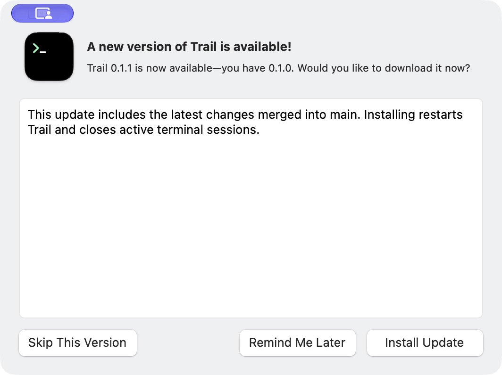
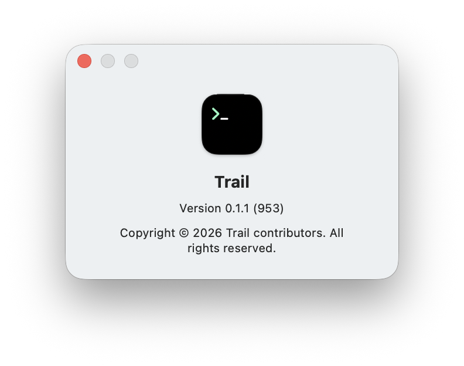

# macOS 0.1.0 → 0.1.1 verification

## Scope

Verify the real GitHub/Sparkle Developer ID distribution path. The baseline is
the published, unmodified Trail 0.1.0 (896), with its HTTPS test-channel feed.
An ad-hoc fixture or a passing build alone does not establish a successful
production-signed upgrade.

## Login and release prerequisites

- Release source: `9bfad0d956135f56d8ae743fb89f486e8c32ab14`.
- macOS Apple login uses `ASWebAuthenticationSession`, directly authorizes with
  Apple, and returns to the app. Developer ID builds do not request the
  unsupported native Apple sign-in entitlement. iOS retains native sign-in.
- The HTTPS callback verifies Apple's ID token and nonce. The app retrieves
  the result once using a separate secret; callback URLs contain no ID token.
- The test backend runs `ianvs-api:9bfad0d9`. A real macOS login returned to
  the client and showed the signed-in account and linked Apple identity.
- Local macOS native tests: 37 passed, 0 failed; Flutter authentication tests:
  11 passed; focused Dart analysis and backend Go tests passed.
- [macOS Update Checks](https://github.com/robinfai/ianvs-terminal/actions/runs/41435591857)
  passed on macOS 15. This run precedes the final system-auth change; the 37
  local native tests above cover the final source revision.
- [Signed release workflow](https://github.com/robinfai/ianvs-terminal/actions/runs/41437760510)
  is the release run used for acceptance.

## Device coverage

Local interactive validation uses macOS 27.0.1 (26A434). This does not claim
interactive verification on macOS 14, 15, or 26, or on Intel hardware.

## Upgrade acceptance

Completed on 2026-11-03 (Asia/Shanghai), using the actual signed GitHub releases.

- The release workflow succeeded and published v0.1.1 (953). Its test-channel
  appcast now advertises 0.1.1; the original 0.1.0 ZIP checksum is unchanged.
- Cleared only `SULastCheckTime` and relaunched the original signed 0.1.0 in a
  temporary acceptance directory. Process 95099 logged successful EdDSA
  appcast verification at 20:29:50 on November 2. Its Software Update window
  appeared without invoking Check for Updates in this launch.
- The offer showed 0.1.1 available and 0.1.0 installed. Sparkle downloaded
  the release and showed Ready to Install.
- Selected Install and Relaunch, then cancelled Trail's quit confirmation.
  The same process remained running and the on-disk version remained 0.1.0 (896).
- Reopened the downloaded update, selected Install and Relaunch, and confirmed
  Quit. Sparkle replaced the app in the same directory and automatically
  relaunched it as process 97319. Both Info.plist and the live About window
  reported **0.1.1 (953)**. No manual bundle replacement or re-signing was used.
- The updated app passed `codesign --verify --deep --strict`, `stapler validate`,
  and `spctl --assess --type execute`; Gatekeeper reported Notarized Developer ID.
- A subsequent Check for Updates displayed “You're up to date” and identified
  Trail 0.1.1 as the newest available version.
- Native accessibility automation operated the update/quit dialogs after the
  window-control tool repeatedly selected the terminal instead of the dialog.
  Testing used the acceptance copy, not `/Applications/Trail.app`.

## Window activation follow-up

Inspection found that app reopening always selected the terminal main window,
even with a native confirmation or another key window open. The follow-up fix
prioritizes the application's modal window, then its visible key window, and
falls back to the existing main-window selection. The Dart shutdown lookup is
unchanged. This is not included in the already-published 0.1.1 archive.

All 40 local native tests passed, including new regressions for modal priority,
preserving a visible update window, hidden-window fallback, and keeping Flutter
as the shutdown target. The follow-up commit is `0f360cb2` and its
[macOS Update Checks CI](https://github.com/robinfai/ianvs-terminal/actions/runs/41444169400)
also passed on macOS 15. The real 0.1.0 → 0.1.1 upgrade above passed; this later
focus refinement is source-verified and awaits a subsequent release.
